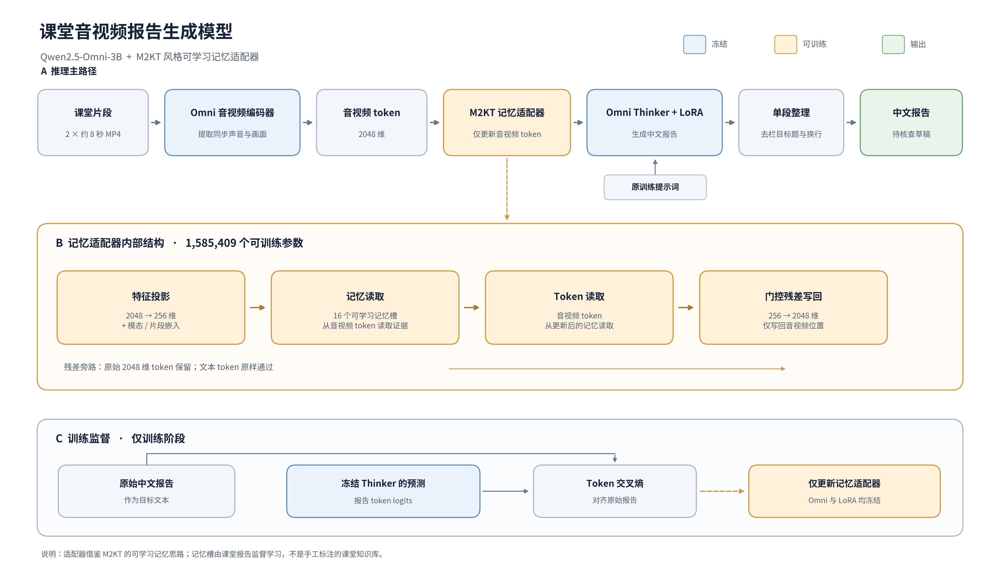

# 课堂音视频报告模型：Omni + M2KT 记忆适配器

当前模型由 Qwen2.5-Omni-3B、课堂报告 LoRA 和 M2KT 风格记忆适配器组成。Omni 读取同步视频与声音，记忆适配器增强音视频 token，Thinker 生成中文报告。训练适配器时冻结基座和 LoRA，只更新记忆模块。已有课堂数据按课程划分为训练 56、验证 10、测试 10 门，每门课选取两段约 8 秒的 MP4。



记忆模块代码见 [classroom_m2kt_adapter.py](classroom_m2kt_adapter.py)。它将 2048 维音视频特征投影到 256 维，使用 16 个记忆槽读取特征，再以门控残差写回音视频 token。共有 1,585,409 个可训练参数。它借鉴原 M2KT 的可学习记忆增强特征思路；没有使用原医学 LAMRG 网络、医学权重或手工督导规则。当前所谓训练标签是**原始中文报告全文**，没有单独的课堂事件分类标签。

## 模型与数据

| 内容 | 位置 |
| --- | --- |
| Omni 基座 | `models_pretrained/Qwen2.5-Omni-3B/` |
| 课堂 LoRA | `results/classroom_omni/lora_v3_10ep/checkpoint-63/` |
| 当前记忆适配器 | `results/classroom_m2kt_adapter/train_v1/best_adapter.pt` |
| 已选音视频片段和划分 | `data/classroom/av_clips_v2/`、`data/classroom/omni_dataset_v3/` |
| 原始视频、原始报告和标注 | `data/classroom/videos/`、`data/classroom/reports/`、`data/classroom/annotation.json` |
| 训练缓存 | `results/classroom_m2kt_adapter/features/`、`results/classroom_m2kt_adapter/targets/` |
| 当前单段验证报告 | `results/classroom_m2kt_adapter/val_single_paragraph/` |

仓库包含标注、原始文字报告、已选短音视频片段、训练清单、特征与目标缓存、实验元数据和验证报告。完整原始课堂录像、Omni 基座权重、课堂 LoRA 权重、记忆适配器权重和本地 `.venv-omni27` 虚拟环境由 `.gitignore` 排除。新环境推理或重新提取特征时需自行准备权重；适配器训练仍需要 Omni 基座和课堂 LoRA 权重，已有缓存可免去重新提取音视频特征。所需包见 `requirements-omni.txt`。部分训练清单和结果元数据保存了原机器的绝对路径，在其他机器使用时需更新路径。

## 推理

在 `M2KT/` 目录运行：

```bash
# 先检查来源、权重和输出路径；不会加载 GPU 模型。
.venv-omni27/bin/python predict_classroom_m2kt_adapter.py --course-id 47506 --dry-run

# 从当前保留的权重生成单段报告。
CUDA_VISIBLE_DEVICES=0 .venv-omni27/bin/python predict_classroom_m2kt_adapter.py --course-id 47506

# 新课程可以直接输入一段或多段带声音的 MP4。
CUDA_VISIBLE_DEVICES=0 .venv-omni27/bin/python predict_classroom_m2kt_adapter.py --clip /path/to/clip.mp4
```

报告默认写入 `results/classroom_m2kt_adapter/predictions/`。`--report-style single-paragraph` 为默认值：沿用原训练提示词和权重，只在输出端去掉“综合评价、优点、问题与建议、总体结论”等栏目标题与换行。`--report-style training` 返回未经排版的原始模型输出。当前版本没有重新训练生成器来学习单段文风。

## 复现适配器训练

```bash
cd M2KT
CUDA_VISIBLE_DEVICES=0 .venv-omni27/bin/python extract_classroom_m2kt_features.py --split train
CUDA_VISIBLE_DEVICES=0 .venv-omni27/bin/python extract_classroom_m2kt_features.py --split val
.venv-omni27/bin/python tokenize_classroom_m2kt_targets.py
.venv-omni27/bin/python train_classroom_m2kt_adapter.py --dry-run
CUDA_VISIBLE_DEVICES=0 .venv-omni27/bin/python train_classroom_m2kt_adapter.py \
  --output-dir results/classroom_m2kt_adapter/retrain
```

若需从原始视频重建训练片段，依次运行 `scripts/prepare_classroom_av.py` 和 `scripts/build_classroom_omni_dataset.py`。当前 `train_v1` 已完成 5 轮训练、70 次优化更新，验证损失从冻结基线的 2.412447 降至 2.411564；改进幅度很小，不能据此认为报告事实更准确。详情见 `train_v1/summary.json`。

## 验证报告与局限

[validation_examples_single_paragraph.md](results/classroom_m2kt_adapter/validation_examples_single_paragraph.md) 列出 10 门验证课，展开其中 6 门。已核对这 10 份生成报告均为单段、无栏目标题。推理只读取音视频片段及其来源信息，不读取验证课原始报告。每门课只有约 16 秒音视频，因此报告是待核查草稿；课程主题、课堂事件、数字和教学成效判断都应与完整录像对照。格式清理本身不会修复事实错误或重复内容。
