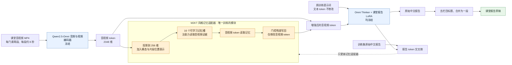

# 课堂音视频报告：Omni + M2KT 记忆适配器

当前只保留这一版课堂报告模型：Qwen2.5-Omni-3B 基座、课堂中文报告 LoRA，以及借鉴 M2KT 可学习记忆思路的音视频特征适配器。推理默认输出一段中文报告。适配器没有直接调用原医学 M2KT 网络，也没有外部课堂知识库。

## 模型结构

训练时以原始报告计算损失，只更新记忆适配器；推理时不读取原始报告。最右侧的单段处理仅调整排版，不改变模型权重。

训练数据、运行命令和局限见 [CLASSROOM_M2KT_ADAPTER.md](CLASSROOM_M2KT_ADAPTER.md)。本地验证集原始报告与生成报告对照保存在 `results/classroom_m2kt_adapter/validation_examples_single_paragraph.md`；课堂数据与报告未上传 GitHub。

主要入口：

- `predict_classroom_m2kt_adapter.py`：使用基座、LoRA 和记忆适配器生成报告。
- `classroom_m2kt_adapter.py`：记忆适配器网络。
- `extract_classroom_m2kt_features.py`、`tokenize_classroom_m2kt_targets.py`、`train_classroom_m2kt_adapter.py`：特征缓存、目标缓存与适配器训练。
- `scripts/prepare_classroom_av.py`、`scripts/build_classroom_omni_dataset.py`：准备同步音视频与训练数据。

本地的基座、LoRA 权重、记忆适配器权重和课堂数据保存在上述代码使用的原有路径；GitHub 提交只包含代码和说明，不上传这些大文件及课堂数据。新环境运行前需自行准备相应文件。许可范围为研究及内部非商业试验。
